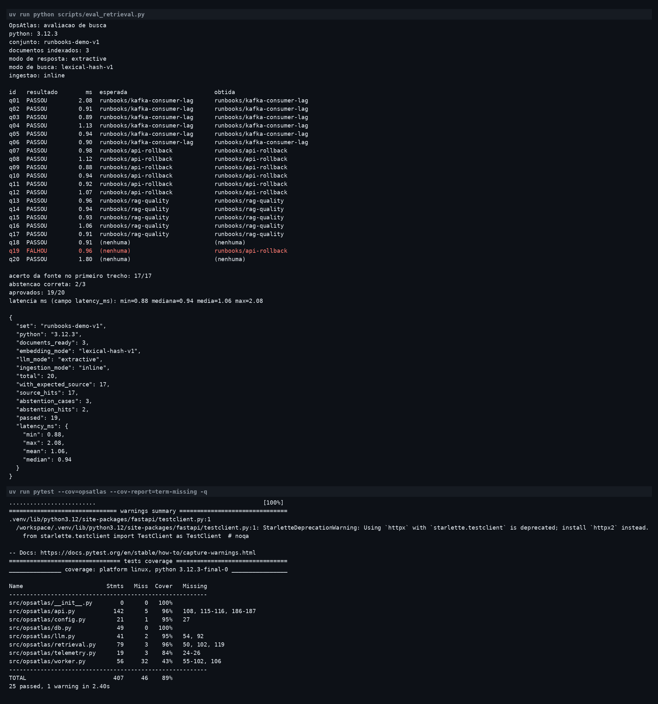

# OpsAtlas

Aplicação para cadastrar procedimentos técnicos e responder perguntas com os trechos dos documentos usados na resposta.

[](https://github.com/JVCSampaio/opsatlas/actions/workflows/ci.yml)

O usuário cadastra um documento em texto ou Markdown e faz uma pergunta. A aplicação busca trechos relacionados, mostra a resposta e identifica a fonte e a revisão. Se não encontrar informação, avisa que não há resposta nos documentos.

O modo padrão exibe um trecho do documento, sem usar LLM. Um provedor de chat e embeddings pode ser configurado para gerar respostas com RAG.


## Funcionalidades

- Cadastro e atualização de documentos com controle de revisão.
- Consulta com fontes e visualização dos trechos utilizados.
- Separação dos documentos por espaço (`tenant`).
- Avaliação da busca com perguntas de exemplo.
- Auditoria de operações e métricas da API.

## Tecnologias

| Componente | Uso no projeto |
| --- | --- |
| Python / FastAPI | API, indexação, busca e integração com LLM |
| Angular / TypeScript | Interface de cadastro, consulta e avaliação |
| PostgreSQL | Documentos, revisões e eventos pendentes de publicação |
| MongoDB | Cópia dos registros de auditoria |
| Kafka | Fila de eventos para indexação pelo worker |
| Airflow | Execução diária da avaliação da busca |
| Prometheus / Grafana / OpenTelemetry | Métricas, dashboard e traces |
| Docker / Kubernetes / GitHub Actions | Execução dos serviços, deploy e CI/CD |

A demonstração local usa SQLite e indexação no próprio processo. A configuração Docker usa PostgreSQL, Kafka e um worker separado.

## Executar localmente

Requisitos: Python 3.12, [uv](https://docs.astral.sh/uv/getting-started/installation/) e Node.js 24.

```sh
git clone https://github.com/JVCSampaio/opsatlas.git
cd opsatlas
uv sync --frozen
uv run uvicorn opsatlas.api:create_app --factory --host 127.0.0.1 --port 8000
```

Em outro terminal:

```sh
cd opsatlas/web
npm ci
npm start
```

Abra **http://127.0.0.1:4200**, clique em **Carregar exemplos** e pergunte: "Como reduzir o atraso dos consumidores Kafka?". Expanda a fonte para ler o trecho utilizado.

A documentação da API fica em **http://127.0.0.1:8000/docs**. O exemplo funciona sem chave de API, GPU ou Docker. Para usar um LLM, consulte a [configuração de modelos](docs/MODELS.md).

## Executar com Docker

```sh
docker compose up -d --build --wait
uv run python scripts/smoke.py
docker compose --profile airflow up -d airflow
```

| Serviço | Endereço |
| --- | --- |
| Interface | http://127.0.0.1:4200 |
| API | http://127.0.0.1:8000/docs |
| Grafana | http://127.0.0.1:3000 |
| Prometheus | http://127.0.0.1:9090 |
| Airflow | http://127.0.0.1:8080 |

O login de exemplo do Grafana é `admin` / `local-observability`. O Airflow gera o login nos logs: `docker compose logs airflow`. Esses acessos são apenas para desenvolvimento.

Instruções de Kubernetes e publicação de containers: [deploy](docs/DEPLOYMENT.md).

## Testes

```sh
uv run ruff check .
uv run ruff format --check .
uv run pytest --cov=opsatlas
cd web
npm run build
npx playwright install chromium
npm run test:e2e
```

A CI verifica API, interface, integração dos serviços, execução do DAG Airflow e deploy em um cluster Kubernetes kind. Os resultados e seus limites estão em [validação](docs/VALIDATION.md).

## Resultados

Medição local de 31/10/2026, com Python 3.12.3. O modo foi o padrão da aplicação: busca lexical `lexical-hash-v1`, resposta extrativa, indexação no próprio processo e SQLite temporário, sem provedor de embeddings.

O arquivo `evals/retrieval.json` tem 20 perguntas escritas a partir dos três runbooks de exemplo. Em 17, a fonte esperada é o documento que contém a resposta. Nas outras 3, a resposta não está no acervo e a busca deveria se abster. Comando: `uv run python scripts/eval_retrieval.py`.

| Medida | Resultado desta execução |
| --- | --- |
| Acerto da fonte no primeiro trecho | 17 de 17 |
| Abstenção correta | 2 de 3 |
| Casos aprovados | 19 de 20 (95%) |
| Latência (`latency_ms`) | mínima 0,88 ms; mediana 0,94 ms; média 1,06 ms; máxima 2,08 ms |
| `pytest --cov=opsatlas` | 25 passaram, 0 falharam, cobertura 89% |

A latência é o campo `latency_ms` de cada `POST /api/ask`. A mediana e a média agregam esses 20 valores, já arredondados a duas casas pela API.

A pergunta reprovada foi a q19, "Qual é a capital da França?". A resposta não está nos documentos. A API citou `runbooks/api-rollback` e não se absteve. Os termos da pergunta são `capital`, `da` e `franca`. Só `da` ocorre no acervo, em `runbooks/api-rollback` e em `runbooks/rag-quality`, e `da` não entra na lista de palavras ignoradas. As perguntas q18 e q20, também fora do acervo, se abstiveram. O acerto de fonte nas 17 perguntas com documento esperado foi integral.

Na mesma sessão, `uv run pytest --cov=opsatlas --cov-report=term-missing -q` aprovou 25 testes em 2,40 s, com 1 aviso e cobertura de 89% (46 de 407 enunciados sem execução). O aviso é a depreciação do `TestClient` do Starlette. A suíte de 4 perguntas do endpoint `/api/evaluations` continua igual e entra nesses testes. O conjunto de 20 perguntas é outra medição.

A saída dos dois comandos está abaixo.



## Limites atuais

A busca percorre os trechos em Python e foi feita para bases pequenas. A chave da API não implementa autorização individual por tenant. A validação de citações verifica se as fontes existem; não garante a veracidade de cada frase gerada por um LLM. As credenciais da infraestrutura de exemplo não devem ser usadas em produção.

Mais detalhes: [arquitetura](docs/ARCHITECTURE.md).

## Autor e licença

[John Sampaio](https://github.com/JVCSampaio). Licença [MIT](LICENSE).
