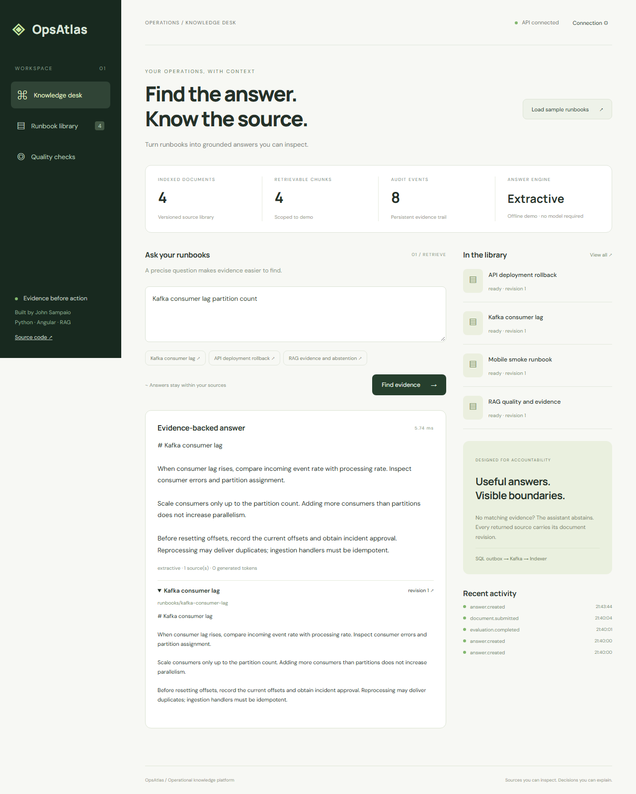
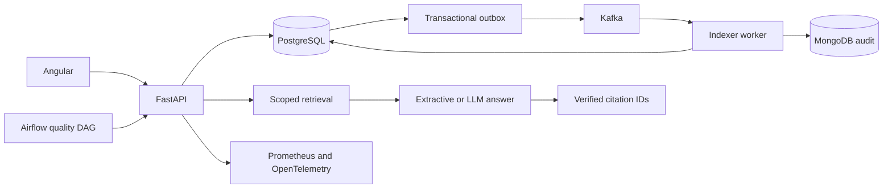

# OpsAtlas

**Ask your operational runbooks. Inspect every source.**

[](https://github.com/JVCSampaio/opsatlas/actions/workflows/ci.yml)


[](LICENSE)

OpsAtlas is an operational knowledge platform built by **John Sampaio**. Upload a runbook, ask a question, and inspect the document revision and excerpt behind the answer. When retrieval finds no evidence, the assistant abstains.



## Try it locally

Requires Python 3.12, [uv](https://docs.astral.sh/uv/getting-started/installation/) and Node.js 24. No model download, API key or Docker required for the offline demo.

```sh
git clone https://github.com/JVCSampaio/opsatlas.git
cd opsatlas
uv sync --frozen
uv run uvicorn opsatlas.api:create_app --factory --host 127.0.0.1 --port 8000
```

In a second terminal:

```sh
cd opsatlas/web
npm ci
npm start
```

Open **http://127.0.0.1:4200**, click **Load sample runbooks**, then ask **“Kafka consumer lag partition count”**. Expand the citation. Try an unrelated question to see abstention, and open **Quality checks** to run the sample evaluation. API documentation: **http://127.0.0.1:8000/docs**.

The default mode uses deterministic lexical retrieval and quotes the best excerpt. It is explicitly labeled **Extractive**. Configure an OpenAI-compatible chat/embedding provider for actual LLM generation and semantic embeddings; see [model setup](docs/MODELS.md).

## What is implemented

| Layer | Implementation |
| --- | --- |
| API | Python/FastAPI, typed validation, tenant-scoped queries, request IDs |
| Interface | Angular + TypeScript, responsive knowledge desk, runbook editor, evidence viewer |
| RAG | Bounded context, lexical/vector scoring, revision-aware citations, no-evidence abstention |
| SQL | SQLite local demo / PostgreSQL deployment; document revisions and transactional outbox |
| NoSQL | MongoDB audit projection with stable event IDs and replay-safe upserts |
| Events | Kafka KRaft; acknowledged publishing, manual consumer commits, duplicate/stale-event handling |
| Orchestration | Airflow daily DAG: seed → await indexing → retrieval quality gate |
| Observability | Prometheus metrics, Grafana dashboard, OpenTelemetry traces via Tempo, JSON request logs |
| Delivery | Container builds, GitHub Actions tests and integration checks, tagged GHCR releases |
| Kubernetes | Kustomize resources, probes, resource budgets, non-root API/worker, persistent data services |

## Full stack

With a working Docker Linux engine:

```sh
docker compose up -d --build --wait
uv run python scripts/smoke.py
```

The UI uses the same URL. This profile runs real PostgreSQL, Kafka, MongoDB and an independent indexing worker. Grafana is at **http://127.0.0.1:3000** (`admin` / `local-observability`, local demo credentials); Prometheus is at **http://127.0.0.1:9090**.

```sh
docker compose --profile airflow up -d airflow
docker compose logs airflow
```

Airflow is at **http://127.0.0.1:8080**; obtain the generated standalone login from its logs. Trigger `knowledge_quality` to run the pipeline. Credentials in the supplied infrastructure are development fixtures. See [deployment](docs/DEPLOYMENT.md) before using an external environment.

## Architecture



Document updates invalidate old retrieval results until the new revision is indexed. Publishing is **at least once**: a crash after a Kafka acknowledgement can resend an event. The indexer locks the document and skips already indexed or superseded revisions. MongoDB projection uses the SQL event UUID as `_id`.

## Verify it

```sh
uv run ruff check .
uv run ruff format --check .
uv run pytest --cov=opsatlas
cd web
npm run build
npx playwright install chromium
npm run test:e2e
```

The browser tests drive the real API: upload, question, source inspection, abstention, evaluation and mobile layout. CI also builds and exercises the real event-driven stack. [Validation evidence](docs/VALIDATION.md) distinguishes observed results from deployment files awaiting execution.

## Engineering choices and boundaries

This is a working portfolio application, not a claim of production certification. Retrieval scans a small corpus in Python; a larger deployment should move ranking and vector indexing into PostgreSQL/pgvector. One deployment key protects API access; tenant headers scope data but do not implement per-user authorization. Citation ID validation prevents nonexistent references, but does not prove that every generated sentence is supported. Production hardening includes identity mapping, rate limits, migration tooling, hardened network access, retention, and a poison-event dead-letter policy.

Read the [architecture decisions](docs/ARCHITECTURE.md), [deployment guide](docs/DEPLOYMENT.md), and [Portuguese interview guide](docs/INTERVIEW.pt-BR.md). Sample runbooks are original synthetic fixtures, with no private operational data.

## License

MIT. Built by [John Sampaio](https://github.com/JVCSampaio).
